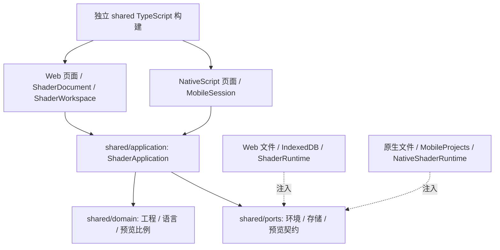

# G02 共享应用状态与业务逻辑

2026-10-16。ShaderLab 的工程与编辑业务已抽离到 `shared`，Web 和移动旧页面接入同一应用实现。本目标不发布 npm、不改 Native/Engine/UI 版本，不迁移通用 UI 控件。

## 模块与依赖



- [领域](../../../shared/domain/model.ts)：`.hyshader` v1 格式、旧工程归一化、解析/校验、75% 等预览比例；旧 Web model 入口兼容转导出。
- [应用](../../../shared/application/application.ts)：唯一工程状态、pass/pane/播放选择、revision/savedRevision、编辑、保存队列、编译、取消与销毁；[actions/selectors](../../../shared/application/state.ts)。
- [服务契约](../../../shared/ports/services.ts)：不携带 DOM、Page 或 GPU 对象。ID/时间可注入；[预览适配器](../../../shared/ports/preparedPreview.ts) 用闭包持有资源，仅对应用暴露句柄。
- [Web 适配](../../../web/src/workspace.ts) 与 [移动适配](../../../mobile/src/session.ts) 保留原入口。Web 教程/页面结构、移动原生控件、代码编辑器、GPU 宿主留在各平台。
- [ADR](../../../docs/for-ai/adr/2026-10-16-g02-shared-application.md) 记录 `shaderlab-application/2`：为兼容 EditorPlatform 的同步事务，将 G01 提案的异步 commit 收敛为同步资源交换；prepare 仍异步。G01 历史冻结不改，通用 UI v1 契约不变。

移动构建不再运行 Web 页面 TypeScript 构建，也不导入 `web/dist`。现有 shader/compiler/sound/教程帮助模块暂时由移动 bundler 从 `web/src` 的显式允许列表取源；因此并不声称整个原生工程可删除 web 源目录。独立业务构建完全不需要 web。

## 核验

当前源码、工具版本、构建身份与所有原始结果索引见 [verification.json](verification.json)。

| 检查 | 覆盖 |
| --- | --- |
| 无界面共享测试 | 无 DOM/NativeScript/GPU 全局；Web/Mobile 适配同序列一致；旧文件；语言切换；预览比例；修改无效时原子回滚 |
| 异步与生命周期 | 保存中继续编辑保持 dirty；排队保存与失败重试；切换工程/销毁后旧保存和诊断不覆盖；同 revision 重复编译只接受最新结果；准备资源取消/事务回滚只释放一次；文件选择晚到丢弃；订阅销毁 |
| 原有单元回归 | Web 模型/语言/编译/自动化，以及移动布局/文档/草稿/文件/连续音频 |
| Web 真实 GPU | 原有完整 browser smoke，含编辑、诊断、保存、导出、重开、Gallery 删除与八个示例 |
| 移动渲染真实 GPU | 原生 Shader 图代码在 Chrome WebGPU 上运行，替换平台文件/图片/视频 IO；八个示例实际出图，通过共享应用编译 100→75→50→25→100→75%，验证读回尺寸；失败保留旧图 |
| 构建边界 | 无 DOM 的独立 shared TypeScript 编译；无 Web 目录的全新源码目录构建 MobileSession；Web 正式构建；Android/iOS Webpack 资源包及 source map 无 web/dist 检查 |

移动 GPU 首次新增比例测试在首帧渲染前读回，报“尚无渲染结果”；修正测试等待首帧后通过。保留 [首次日志](results/mobile-gpu-before-frame-wait.log)，不将测试等待问题记作运行时修复。

可复现命令（ShaderLab 根目录）：

```sh
npm run typecheck
npm test
npm run check:boundaries
npm run test:shared:fresh
npm run build
node web/test/browser-smoke.mjs
node mobile/test/gpu-browser.mjs
npm run bundle:ios
npm run bundle:android
```

`test:shared` 独立编译 shared，适配测试直接打包 Web 源，不要求 Web dist。`test:shared:fresh` 不复制 web、平台包或已有产物，但使用当前 lock 对应的已安装构建工具；它不是完整 npm 安装/发布测试。资源包也不是 IPA/APK，更不代表真机 UI 通过。

## G07 交接

本次未安装设备。iPhone、iPad、Android 对当前构建的输入、文件选择取消、保存与重开、预览比例、旋转、后台恢复，以及 Safari/共享 UI 新旧性能比较，由 `g07-shaderlab-slice` 验收。此前版本 IPA 的通过结果不继承到本批源码。桌面 UI 属于 G08，最终候选/全新依赖安装属于 G10。G02 没有尚未解决的纯业务或旧工程格式阻塞；不声称 G03–G10 完成。
